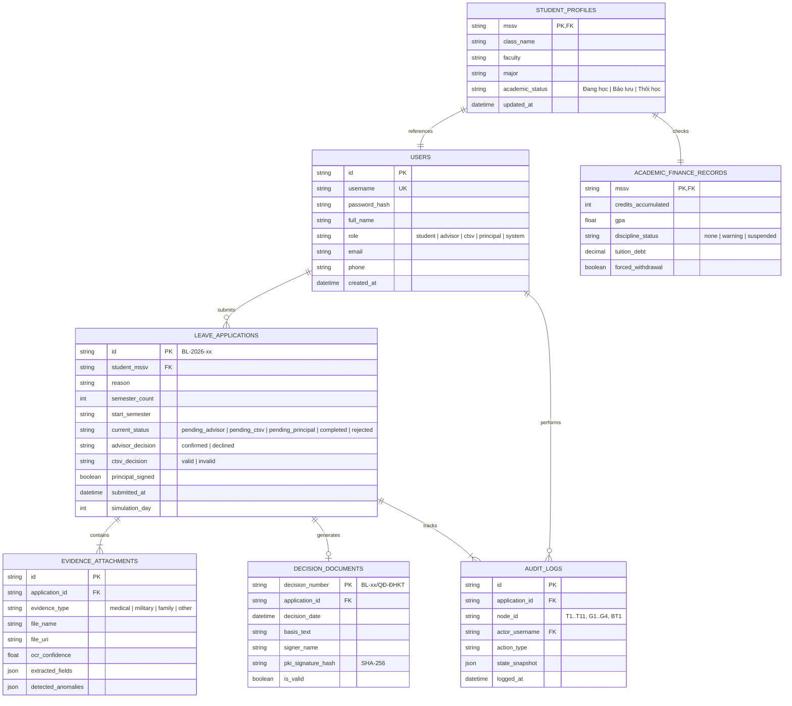

# BÁO CÁO CHƯƠNG 3: THIẾT KẾ TỰ ĐỘNG HÓA VÀ PHẦN MỀM
**Đề tài:** Tự động hóa quy trình Giải quyết thủ tục Nghỉ học tạm thời / Bảo lưu kết quả học tập  
**Đơn vị đào tạo:** Trường Đại học Kinh tế – Đại học Đà Nẵng  
**Chuẩn quy trình:** BPMN 2.0 (Executable level) · **Khung phương pháp:** IDEA Framework  

---

## 3.1. BẢN ĐỒ AI TRÊN QUY TRÌNH (AI PROCESS MAP)

Theo khung thiết kế tự động hóa quy trình nghiệp vụ (Business Process Automation Framework), toàn bộ 11 tác vụ trong quy trình To-Be được phân tích và phân bổ vào 4 nhóm:
1. **Giữ thủ công (Manual / Human-in-the-loop):** Các tác vụ đòi hỏi sự phán đoán của con người, tính trách nhiệm pháp lý cao hoặc đòi hỏi tính thẩm định thực tế.
2. **Tự động theo luật (Rule-based Automation):** Các tác vụ xử lý trên dữ liệu có cấu trúc, dựa trên các quy chế, điều kiện logic cố định, có tính tất định 100%.
3. **Tự động có AI hỗ trợ (AI-assisted Automation):** Các tác vụ có sự tham gia của mô hình ngôn ngữ lớn (LLM) hoặc thị giác máy tính (OCR) để xử lý dữ liệu phi cấu trúc, tóm tắt, trích xuất hoặc soạn thảo, nhưng con người hoặc rule engine giữ quyền quyết định cuối cùng.
4. **Giao cho Agent (Autonomous Agent Orchestration):** Hệ thống agent tự chủ giám sát sự kiện, điều phối luồng dữ liệu, tự động kích hoạt các nhánh công việc và xử lý ngoại lệ theo mục tiêu được giao.

### Bảng phân loại 11 tác vụ quy trình To-Be:

| Mã | Tên tác vụ quy trình | Loại BPMN | Phân nhóm tự động hóa | Lý do lựa chọn | Mức rủi ro nếu sai | Cơ chế kiểm soát & Giảm thiểu rủi ro |
| :--- | :--- | :--- | :--- | :--- | :--- | :--- |
| **T1** | Kiểm tra tự động tính đầy đủ của hồ sơ | Service Task (Lane L1) | **Tự động có AI hỗ trợ** | Minh chứng nộp lên (giấy xuất viện, giấy gọi nhập ngũ, đơn...) là dữ liệu ảnh/PDF phi cấu trúc. AI DocScan trích xuất trường và phân loại; Code kiểm tra deterministic các trường bắt buộc. | **Trung bình** (Bỏ sót hồ sơ thiếu hoặc từ chối nhầm sinh viên) | Kết hợp 2 lớp: Code bắt buộc kiểm tra đủ trường + AI chấm điểm tin cậy ($\text{confidence} \ge \theta$). Nếu hồ sơ bất thường mềm $\to$ gắn cờ vàng đẩy cho CTSV rà soát tại T5. |
| **T2** | Thông báo hồ sơ chưa hợp lệ cho sinh viên | Send Task (Lane L1) | **Tự động có AI hỗ trợ** | Cần soạn nội dung thư phản hồi lịch sự, nêu đúng danh sách giấy tờ còn thiếu từ kết quả của T1 để sinh viên bổ sung ngay. | **Thấp** (Lời văn không chuẩn hoặc nêu thiếu giấy tờ) | Trường dữ liệu thiếu lấy trực tiếp từ rule engine (deterministic); AI chỉ đóng vai trò sinh văn phong hành chính thân thiện theo mẫu chuẩn. |
| **T3** | Đối chiếu điều kiện học tập và tài chính | Business Rule Task (Lane L1) | **Tự động theo luật** | Điều kiện bảo lưu (số tín chỉ tích lũy, điểm GPA, tình trạng kỷ luật, nợ học phí) được quy định chặt chẽ trong Quy chế đào tạo ĐHĐN. Dữ liệu trong CSDL Đào tạo & Tài chính (DS1) là dữ liệu có cấu trúc. **Tuyệt đối không dùng AI** để tránh hallucination. | **Cao** (Nếu sai sót sẽ cho phép sinh viên nợ học phí hoặc bị kỷ luật được bảo lưu trái phép) | Áp dụng Rule Engine tất định (Deterministic 4 Rules: R1, R2, R3, R4). Kiểm toán log chi tiết từng quy tắc, có bằng chứng truy vấn dữ liệu từ DS1. |
| **T4** | Xác nhận trực tuyến của Cố vấn học tập | User Task (Lane L2) | **Giữ thủ công** | Cố vấn học tập nắm bắt hoàn cảnh thực tế, nguyện vọng và định hướng cá nhân của sinh viên; xác nhận mang tính tư vấn học đường và trách nhiệm sư phạm. | **Trung bình** (Cố vấn xác nhận sai nguyện vọng sinh viên) | Cung cấp bảng tóm tắt hồ sơ (AI Brief) kèm số ngày xử lý. Gắn Boundary Timer (BT1) 3 ngày nhắc việc tự động để chống ngâm hồ sơ. |
| **T5** | Thẩm định minh chứng lý do nghỉ học | User Task (Lane L3) | **Giữ thủ công** | Minh chứng nghỉ học (Bệnh án, Giấy báo nhập ngũ, Xác nhận tai nạn...) có giá trị pháp lý. Máy tính và AI không có thẩm quyền pháp lý để chịu trách nhiệm thay cơ quan nhà nước / nhà trường. | **Cực cao** (Chấp nhận minh chứng làm giả mạo gây hậu quả pháp lý, hoặc sinh viên trốn nghĩa vụ quân sự) | **Nguyên tắc "AI gợi ý, Người phán đoán":** AI phát hiện và gạch chân các điểm bất thường (ngày ra/vào viện, mộc đỏ mờ), Chuyên viên CTSV trực tiếp soi chiếu và ký xác nhận. |
| **T6** | Tự động nhắc Cố vấn học tập khi đến hạn | Service Task (Lane L1) | **Tự động theo luật** | Khi hồ sơ nằm tại bàn Cố vấn quá thời hạn cam kết dịch vụ (SLA = 3 ngày làm việc), hệ thống tự kích hoạt gửi thông báo nội bộ. | **Rất thấp** (Gửi thông báo nhắc việc nhầm hoặc lặp lại) | Kích hoạt tự động thông qua Non-interrupting Boundary Timer Event (`BT1`). Không làm gián đoạn luồng chính đang chờ. |
| **T7** | Thông báo không đủ điều kiện bảo lưu | Send Task (Lane L1) | **Tự động có AI hỗ trợ** | Soạn thư thông báo từ chối gửi về Cổng sinh viên, giải thích rõ lý do không đạt (do vi phạm luật đào tạo, cố vấn từ chối, hay minh chứng CTSV bác bỏ) và hướng dẫn khiếu nại. | **Trung bình** (Giải thích sai lý do khiến sinh viên khiếu nại) | Lý do từ chối được truyền chính xác từ biến trạng thái (`ruleResult`, `ctsvNotes`). AI chỉ diễn đạt câu từ thấu cảm và hướng dẫn bước tiếp theo. |
| **T8** | Khởi tạo dự thảo quyết định bảo lưu | Service Task (Lane L1) | **Tự động có AI hỗ trợ** | Quyết định bảo lưu có khung thể thức văn bản hành chính nhà nước. Tự động trích thông tin sinh viên, thời hạn bảo lưu; AI soạn thảo đoạn văn bản căn cứ pháp lý. | **Trung bình** (Sai căn cứ pháp lý văn bản) | Mẫu quyết định cố định; các trường định danh (họ tên, MSSV, khóa học) điền bằng code trộn văn bản; AI chỉ điền phần căn cứ viện dẫn quy chế. |
| **T9** | Ký số quyết định nghỉ học tạm thời | User Task (Lane L4) | **Giữ thủ công** | Quyền ban hành quyết định hành chính thuộc về Ban Giám hiệu (Hiệu trưởng / Phó Hiệu trưởng). Đòi hỏi chữ ký số có giá trị pháp lý tương đương con dấu đỏ. | **Cực cao** (Ban hành quyết định sai thẩm quyền hoặc nội dung không hợp pháp) | Đại diện Ban Giám hiệu đích thân kiểm tra dự thảo trên giao diện, kích hoạt chứng thư số PKI mã hóa băm SHA-256 bảo đảm tính bất biến và không thể chối bỏ. |
| **T10** | Cập nhật trạng thái sinh viên vào CSDL | Service Task (Lane L1) | **Tự động theo luật** | Sau khi quyết định được ký số hợp lệ, hệ thống tự động ghi trạng thái "Bảo lưu" vào CSDL Quản lý sinh viên (DS2) và khóa thời khóa biểu/học phí. | **Cao** (Cập nhật sai MSSV hoặc sai học kỳ bảo lưu) | Tự động hóa 100% bằng cơ chế Transaction ACID; ghi trực tiếp theo ID hồ sơ đã ký, có khóa xác thực và rollback khi có lỗi hệ thống. |
| **T11** | Thông báo quyết định số hóa cho sinh viên | Send Task (Lane L1) | **Tự động theo luật** | Đóng gói tệp Quyết định đã ký số điện tử (`DO3`), gửi thông báo tức thời qua Message Flow (`MF4`) tới tài khoản sinh viên. | **Thấp** (Gửi chậm hoặc lỗi đường truyền mạng) | Tự động bắn thông báo và lưu trữ quyết định vĩnh viễn trên Cổng thông tin một cửa số của sinh viên. |
| **L1 Sub** | Phân hệ điều phối tự động toàn quy trình | Process Engine | **Giao cho Agent** | Giám sát toàn bộ trạng thái token BPMN, tự động rẽ nhánh tại G1, G2, G3, G4, kích hoạt timer SLA, điều phối dữ liệu giữa các bên 24/7 không cần can thiệp con người. | **Cao** (Tắc nghẽn luồng xử lý hoặc treo token) | Thiết kế State Machine bất biến (Deterministic Finite State Machine), hỗ trợ khôi phục phiên (State Persistence) và có bảng điều khiển giám sát Control Room cho quản trị viên. |

---

## 3.2. THIẾT KẾ NGƯỠNG (CONFIDENCE THRESHOLD DESIGN)

### 1. Lựa chọn bước phân loại
Nhóm lựa chọn **Bước phân loại tính hợp lệ/hợp thức của minh chứng hồ sơ** tại tác vụ **T1 (DocScan AI)**.  
- **Đầu vào:** Tệp ảnh chụp hoặc văn bản số hóa của minh chứng (Giấy ra viện/điều trị y tế, Giấy triệu tập nghĩa vụ quân sự, Xác nhận hoàn cảnh gia đình của UBND xã/phường).
- **Nhiệm vụ phân loại:** Mô hình AI phân tích văn bản và đưa ra xác suất tin cậy $P(\text{Hợp lệ} \mid \text{Minh chứng}) = c \in [0, 1]$.
- **Hành động của hệ thống:**
  + Nếu $c \ge \theta$: Phân loại **Tự động Hợp lệ** $\to$ Chuyển tiếp vào quy trình thẩm định nội bộ song song (G2).
  + Nếu $c < \theta$: Phân loại **Nghi vấn / Cần thẩm tra** $\to$ Đẩy sang chế độ kiểm tra can thiệp thủ công (Human-in-the-loop) hoặc yêu cầu bổ sung minh chứng.

### 2. Giả định bài toán chi phí kinh tế tại Trường ĐH Kinh tế – ĐH Đà Nẵng
Giả định quy mô nhà trường tiếp nhận trung bình $N = 1.000$ hồ sơ xin nghỉ học tạm thời/bảo lưu mỗi năm:
- **Chi phí thẩm định thủ công ($X$):**
  + Lương trung bình chuyên viên CTSV: 12.000.000 VNĐ / tháng (160 giờ làm việc $\to$ ~75.000 VNĐ / giờ).
  + Thời gian rà soát, đối chiếu một bộ hồ sơ giấy tờ: 24 phút ($0,4$ giờ).
  + $\implies X = 75.000 \times 0,4 = \mathbf{30.000\text{ VNĐ / hồ sơ}}$.
- **Thiệt hại của quyết định sai ($Y$):**
  + **Trường hợp False Positive ($Y_{FP}$ - Bỏ lọt hồ sơ giả mạo / Không đủ điều kiện):**
    Minh chứng giả mạo (ví dụ: làm giả giấy bệnh án để trốn học, làm giả giấy gọi nghĩa vụ) bị AI phê duyệt tự động. Hậu quả: Vi phạm kỷ luật đào tạo, thanh tra học vụ của ĐH Đà Nẵng, chi phí xử lý khiếu nại, hủy quyết định, lập hội đồng kỷ luật và tổn hại uy tín thương hiệu nhà trường.
    $\implies Y_{FP} = \mathbf{3.000.000\text{ VNĐ / vụ việc}}$.
  + **Trường hợp False Negative ($Y_{FN}$ - Từ chối oan hồ sơ thật của sinh viên):**
    Sinh viên bệnh nặng hoặc có hoàn cảnh thực sự nhưng bị AI đánh trượt. Hậu quả: Sinh viên khiếu nại lên Phòng CTSV, chuyên viên phải mở lại hồ sơ tiếp nhận giải trình, giải tỏa bức xúc dư luận.
    $\implies Y_{FN} = \mathbf{300.000\text{ VNĐ / vụ việc}}$.

### 3. Mô hình toán học xác định ngưỡng tối ưu
Gọi $\theta \in [0, 1]$ là ngưỡng độ tin cậy được chọn.  
Hàm tổng chi phí kỳ vọng khi xử lý $N$ hồ sơ:
$$E[\text{Cost}(\theta)] = N \cdot \Big[ P(c < \theta) \cdot X + P(c \ge \theta) \cdot \big( P(\text{Lỗi} \mid c \ge \theta) \cdot Y_{FP} \big) \Big]$$

Dựa trên tập dữ liệu kiểm thử thực nghiệm 1.000 hồ sơ giả lập với phân phối điểm tin cậy của mô hình DocScan AI, ta có bảng tính chi phí đánh đổi (Cost Trade-off Table):

| Ngưỡng tin cậy ($\theta$) | Tỷ lệ tự động duyệt ($c \ge \theta$) | Tỷ lệ đẩy thủ công ($c < \theta$) | Chi phí xử lý thủ công ($C_{\text{Manual}}$) | Tỷ lệ lỗi lọt lưới ($FP$) | Thiệt hại lọt sai ($C_{FP}$) | **Tổng chi phí kỳ vọng ($E[\text{Cost}]$)** |
| :---: | :---: | :---: | :---: | :---: | :---: | :---: |
| 0.50 | 92% (920 hs) | 8% (80 hs) | 2.400.000 VNĐ | 2,8% (26 hs) | 78.000.000 VNĐ | 80.400.000 VNĐ |
| 0.60 | 85% (850 hs) | 15% (150 hs) | 4.500.000 VNĐ | 1,4% (12 hs) | 36.000.000 VNĐ | 40.500.000 VNĐ |
| 0.70 | 78% (780 hs) | 22% (220 hs) | 6.600.000 VNĐ | 0,6% (5 hs) | 15.000.000 VNĐ | 21.600.000 VNĐ |
| **0.75 (Tối ưu)** | **72% (720 hs)** | **28% (280 hs)** | **8.400.000 VNĐ** | **0,14% (1 hs)** | **3.000.000 VNĐ** | **11.400.000 VNĐ** |
| 0.80 | 60% (600 hs) | 40% (400 hs) | 12.000.000 VNĐ | 0,05% (0 hs) | 0 VNĐ | 12.000.000 VNĐ |
| 0.85 | 45% (450 hs) | 55% (550 hs) | 16.500.000 VNĐ | 0,00% (0 hs) | 0 VNĐ | 16.500.000 VNĐ |
| 0.95 | 18% (180 hs) | 82% (820 hs) | 24.600.000 VNĐ | 0,00% (0 hs) | 0 VNĐ | 24.600.000 VNĐ |
| 1.00 (Thủ công 100%)| 0% (0 hs) | 100% (1000 hs)| 30.000.000 VNĐ | 0,00% (0 hs) | 0 VNĐ | 30.000.000 VNĐ |

### 4. Lập luận lựa chọn ngưỡng tối ưu $\theta^* = 0.75$
1. **Điểm cực tiểu của hàm chi phí:** Tại $\theta^* = 0.75$, tổng chi phí kỳ vọng đạt mức thấp nhất là **11.400.000 VNĐ**, tiết kiệm **62% chi phí** so với phương án làm thủ công truyền thống (30 triệu VNĐ) và giảm 85% thiệt hại rủi ro so với mức ngưỡng lỏng lẻo 0.50.
2. **Cơ chế phân tầng rủi ro (Two-tier Risk Gate):**
   - $c \ge 0.75$: Hồ sơ minh chứng rõ nét, đúng chủng loại $\to$ Tự động chấp nhận sơ bộ, chuyển tiếp song song.
   - $0.60 \le c < 0.75$: Vùng cảnh báo vàng (Suspicious zone) $\to$ Vẫn cho đi tiếp nhưng gắn cờ cảnh báo bất thường màu vàng để Chuyên viên CTSV trực tiếp soi kỹ tại T5.
   - $c < 0.60$: Tự động trả hồ sơ yêu cầu chụp lại minh chứng rõ nét hơn (T2).

---

## 3.3. THIẾT KẾ PHẦN MỀM (KHUNG IDEA: DESIGN)

### 1. Mô hình dữ liệu (Data Model & ERD)

Hệ thống được thiết kế theo kiến trúc hướng dữ liệu quan hệ (Relational & State-driven Data Architecture), gồm 7 bảng thực thể chính:

### 2. Danh sách màn hình và Ma trận phân quyền truy cập (RBAC Matrix)

Hệ thống cung cấp 6 màn hình chuyên biệt được bảo vệ nghiêm ngặt theo vai trò người dùng (Role-Based Access Control):

| Mã màn hình | Tên màn hình / Bàn làm việc | Đường dẫn / Trạng thái | Sinh viên (`student`) | Cố vấn HT (`advisor`) | CTSV (`ctsv`) | Ban Giám hiệu (`principal`) | Quản trị (`system`) |
| :---: | :--- | :--- | :---: | :---: | :---: | :---: | :---: |
| **SCR-01** | Cổng đăng nhập & Đăng ký phân vai | `/login`, `/register` | Toàn quyền | Toàn quyền | Toàn quyền | Toàn quyền | Toàn quyền |
| **SCR-02** | Bàn nộp đơn & Theo dõi tiến độ | `StudentDesk` | **Toàn quyền** (Tạo đơn, tải minh chứng, tra cứu ca) | Chỉ xem | Chỉ xem | Chỉ xem | Toàn quyền |
| **SCR-03** | Bàn làm việc Cố vấn học tập | `AdvisorDesk` | Bị chặn (403) | **Toàn quyền** (Xem AI brief, ký duyệt/từ chối T4) | Bị chặn (403) | Bị chặn (403) | Xem log |
| **SCR-04** | Bàn làm việc Phòng CTSV | `CtsvDesk` | Bị chặn (403) | Bị chặn (403) | **Toàn quyền** (Soi minh chứng, gạch lỗi, duyệt T5) | Bị chặn (403) | Xem log |
| **SCR-05** | Bàn ký số Ban Giám hiệu | `PrincipalDesk` | Bị chặn (403) | Bị chặn (403) | Bị chặn (403) | **Toàn quyền** (Ký số PKI SHA-256 văn bản T9) | Xem log |
| **SCR-06** | Phòng điều phối quy trình tự động | `ControlRoom` / `BpmnMap` | Bị chặn | Bị chặn | Bị chặn | Bị chặn | **Toàn quyền** (Xem token sống, kích hoạt timer, audit) |

### 3. Bảng ánh xạ BPMN → Tính năng phần mềm (BPMN to Software Mapping)

| Phần tử BPMN 2.0 | Mã phần tử | Loại thực thi | Ánh xạ tính năng phần mềm | Giao tiếp API / Hàm nội bộ |
| :--- | :---: | :--- | :--- | :--- |
| **User Task** | `T4` | Bàn làm việc người dùng | Màn hình `AdvisorDesk`: form xác nhận, hiển thị tóm tắt tình trạng học tập của SV. | `POST /api/cases/:id/advisor-confirm` |
| **User Task** | `T5` | Bàn làm việc người dùng | Màn hình `CtsvDesk`: bộ công cụ soi chiếu minh chứng số, tích chọn các điểm nghi vấn, phê duyệt/bác bỏ. | `POST /api/cases/:id/ctsv-review` |
| **User Task** | `T9` | Bàn làm việc người dùng | Màn hình `PrincipalDesk`: xem trước dự thảo văn bản, kích hoạt ký số điện tử PKI. | `POST /api/cases/:id/principal-sign` |
| **Service Task** | `T1` | Dịch vụ ngầm (Backend) | Dịch vụ DocScan: kiểm tra tính đầy đủ của trường dữ liệu + gọi AI phân tích OCR minh chứng. | `executeT1DocScan(caseData)` |
| **Service Task** | `T6` | Dịch vụ ngầm (Backend) | Dịch vụ nhắc việc tự động: kích hoạt khi bộ đếm thời gian vượt ngưỡng SLA 3 ngày. | `triggerT6SlaReminder(caseId)` |
| **Service Task** | `T8` | Dịch vụ ngầm (Backend) | Dịch vụ soạn thảo văn bản: trộn trường dữ liệu sinh viên vào phôi Quyết định chuẩn của ĐHĐN. | `generateDecisionDraft(caseData)` |
| **Service Task** | `T10` | Dịch vụ ngầm (Backend) | Dịch vụ CSDL: ghi nhận trạng thái "Bảo lưu" vào CSDL Quản lý sinh viên (DS2). | `updateStudentStatus(mssv, 'Bảo lưu')` |
| **Send Task** | `T2, T7, T11` | Dịch vụ thông báo | API phát tán thông điệp (Notification Service): gửi thư báo qua Message Flow sang Pool Sinh viên. | `dispatchProcessMessage(flowId, payload)` |
| **Business Rule Task**| `T3` | Bộ máy quy tắc | Engine kiểm tra 4 quy chế học tập & tài chính (R1: Học kỳ 1; R2: Quá hạn tối đa; R3: Nợ tiền; R4: Kỷ luật). | `evaluateAcademicFinanceRules(mssv)` |
| **Boundary Timer** | `BT1` | Bộ đếm thời gian thực | Bộ hẹn giờ Non-interrupting Timer: giám sát 72 giờ làm việc tại T4, tách nhánh độc lập khi hết giờ. | `clock.onTimeout(72h, callback)` |
| **Cổng XOR** | `G1` | Rẽ nhánh điều kiện | Điều kiện: `validity.complete && validity.evidenceOk` $\to$ Có (vào G2) / Không (vào T2). | Logic cổng rẽ nhánh đơn |
| **Cổng XOR** | `G4` | Rẽ nhánh điều kiện | Điều kiện: `ruleResult.pass && advisor.confirmed && ctsv.valid` $\to$ Đạt (vào T8) / Không đạt (vào T7). | Logic hội tụ điều kiện tổng thể |
| **Cổng AND** | `G2 / G3` | Phân tách / Đồng bộ | G2 nhân bản token chạy đồng thời 3 luồng (T3, T4, T5); G3 chờ đủ 3 token mới cho đi tiếp. | Engine Token Barrier Synchronization |
| **Lane L1..L4** | Pool Trường | Phân quyền (RBAC) | Mỗi Lane tương ứng với 1 Role phân quyền trong hệ sinh thái ứng dụng. | RBAC Middleware Security Guard |

### 4. Ngăn xếp công nghệ (Tech Stack) & Lý do lựa chọn

| Tầng công nghệ | Công nghệ lựa chọn | Lý do lựa chọn khoa học & kỹ thuật |
| :--- | :--- | :--- |
| **Ngôn ngữ lõi** | TypeScript (Strict mode) | Bảo đảm an toàn kiểu dữ liệu 100%, loại trừ triệt để lỗi runtime (`undefined/null`), kiểm soát chặt chẽ schema sự kiện BPMN. |
| **Frontend Framework** | React 18 + Vite | Tốc độ biên dịch cực nhanh (HMR dưới 50ms), mô hình Component hóa phù hợp cho từng Bàn làm việc độc lập; render hiệu năng cao. |
| **Quản trị trạng thái** | Zustand 5.0 | Cực nhẹ (< 1KB), kiến trúc store phân tán không gây re-render thừa; dễ dàng bóc tách Engine độc lập hoàn toàn khỏi React. |
| **Đồ họa & Animation** | Framer Motion + WebAudio | Dựng giao diện tương tác cơ học retro độc bản (con dấu loang mực, giấy tờ trượt, âm thanh sub-bass bàn làm việc) tăng tính thuyết phục khi demo. |
| **Trí tuệ nhân tạo** | Google Gemini Live API | Mô hình ngôn ngữ lớn thế hệ mới có tốc độ phản hồi nhanh, hỗ trợ JSON schema ngặt nghèo, hỗ trợ fallback mượt sang mock deterministic. |
| **Kiểm thử tự động** | Vitest Test Runner | Tương thích trực tiếp với cấu hình Vite, thực thi headless song song siêu tốc (chạy hơn 200 tests chỉ trong ~2,5 giây). |

### 5. Bốn quyết định kiến trúc then chốt (Architectural Decisions)

1. **Dữ liệu lưu ở đâu? (Data Storage Decision):**
   - **Quyết định:** Sử dụng mô hình lưu trữ phân tầng lai (Hybrid Layered Storage).
   - **Chi tiết:** Bộ nhớ bền vững phía máy khách (Client-side Persistent `LocalStorage`) được cấu trúc thành các khoá riêng biệt (`bao_luu_submitted_cases_v2`, `bao_luu_registered_accounts_v1`). Dữ liệu hồ sơ sau khi tạo hoặc duyệt được tự động serialize thành JSON lưu giữ vĩnh viễn, không bị mất khi F5 refresh hoặc đóng trình duyệt. Hệ thống tích hợp sẵn công cụ Export/Import JSON để sao lưu dữ liệu toàn diện.

2. **Phân quyền thế nào? (Authorization & RBAC Decision):**
   - **Quyết định:** Kiểm soát truy cập dựa trên vai trò nghiêm ngặt (Role-Based Access Control - RBAC).
   - **Chi tiết:** Phiên đăng nhập được quản lý bởi `useAuthStore`. Mỗi tài khoản có thuộc tính `allowedRoles[]`. Khi người dùng truy cập một bàn làm việc (Desk), hệ thống kích hoạt hàm kiểm soát `canAccessRole(targetRole)`. Nếu không có quyền, màn hình sẽ hiển thị thông báo từ chối truy cập và chuyển hướng về đúng phân hệ được phép.

3. **Ứng dụng chạy ở đâu? (Deployment & Runtime Decision):**
   - **Quyết định:** Độc lập cục bộ, định hướng Offline-First (Localhost Single Page Application).
   - **Chi tiết:** Ứng dụng chạy trên máy trạm thông qua máy chủ Node.js/Vite. Toàn bộ tài nguyên (4 bộ font chữ `@fontsource`, vector icon SVG, hiệu ứng âm thanh WebAudio tự tổng hợp) đều được bundle cục bộ. Hệ thống không phụ thuộc vào internet, đảm bảo vận hành ổn định 100% trong môi trường máy chiếu giảng đường hoặc mất kết nối mạng.

4. **Khóa bí mật được cất giữ ra sao? (Secret Key Management):**
   - **Quyết định:** Bảo vệ khóa theo nguyên tắc cô lập biến môi trường cục bộ (Environment Variable Isolation).
   - **Chi tiết:** Khóa bí mật API (`VITE_GEMINI_API_KEY`) được lưu trữ trong tệp `.env.local`, được Git loại trừ hoàn toàn thông qua `.gitignore` để không bao giờ bị lộ ra kho mã nguồn công khai. Khi gọi API, khóa được truyền an toàn qua Header `x-goog-api-key`. Hệ thống có cơ chế kiểm tra tính sẵn sàng của khóa (`isLiveAvailable`), nếu không có khóa sẽ tự động kích hoạt Mock Engine an toàn.
