# BÁO CÁO CHƯƠNG 4: XÂY DỰNG, KIỂM THỬ VÀ ĐÁNH GIÁ
**Đề tài:** Tự động hóa quy trình Giải quyết thủ tục Nghỉ học tạm thời / Bảo lưu kết quả học tập  
**Đơn vị đào tạo:** Trường Đại học Kinh tế – Đại học Đà Nẵng  
**Phiên bản ứng dụng:** Web Demo "Bảo lưu, Please!" v2.0-TO-BE  

---

## 4.1. ỨNG DỤNG WEB & CHỨNG MINH 6 YÊU CẦU KỸ THUẬT TỐI THIỂU

### 1. Mô tả tổng quan ứng dụng
Ứng dụng web **"Bảo lưu, Please!"** là hệ thống mô phỏng và vận hành thực tế quy trình To-Be số hóa thủ tục nghỉ học tạm thời / bảo lưu kết quả học tập tại Trường ĐH Kinh tế – ĐH Đà Nẵng. Ứng dụng kết hợp giữa phong cách tương tác công sở cơ học retro (bàn làm việc, hồ sơ giấy tờ, con dấu dập mực loang, hiệu ứng âm thanh máy cơ) và công nghệ điều phối quy trình hiện đại (BPMN 2.0 State Machine, AI DocScan, Rule Engine và Ký số PKI SHA-256).

Hệ thống hỗ trợ 2 chế độ vận hành song song:
1. **Chế độ Mô phỏng Đào tạo (Demo Simulation Mode):** Người dùng có thể chạy 5 kịch bản preset (S1–S5), quan sát token di chuyển thời gian thực trên bản đồ BPMN 2.0 sống, bật chế độ thuyết trình tự động (Director Mode), hoặc tua thời gian ảo qua các ngày làm việc.
2. **Chế độ Cổng Một cửa số Thực tế (Portal Mode):** Người dùng đăng nhập theo vai trò thực tế (Sinh viên, Cố vấn học tập, Chuyên viên CTSV, Ban Giám hiệu), trực tiếp tạo hồ sơ, đính kèm minh chứng, xét duyệt, đóng mộc và ký số với dữ liệu được lưu trữ bền vững.

---

### 2. Bảng chứng minh đáp ứng 6 yêu cầu kỹ thuật tối thiểu

| STT | Yêu cầu kỹ thuật tối thiểu | Hiện trạng triển khai trong ứng dụng | Minh chứng mã nguồn & Thao tác kiểm chứng | Kết luận |
| :---: | :--- | :--- | :--- | :---: |
| **1** | **Xác thực với $\ge 3$ vai trò** | Hệ thống triển khai **5 vai trò độc lập**:<br>1. Sinh viên (`student`)<br>2. Cố vấn học tập (`advisor`)<br>3. Phòng Công tác sinh viên (`ctsv`)<br>4. Ban Giám hiệu (`principal`)<br>5. Quản trị điều phối (`system`) | • Tệp `src/store/useAuth.ts` & `src/data/userRegistry.ts`.<br>• Giao diện `src/ui/scenes/LoginPortal.tsx` và `RegisterForm.tsx`.<br>• Có cơ chế kiểm soát truy cập phân quyền: Tài khoản sinh viên không thể truy cập bàn Cố vấn, CTSV hay BGH; Cố vấn chỉ duyệt hồ sơ khoa mình phụ trách. | **ĐẠT**<br>(5/3 vai trò) |
| **2** | **$\ge 3$ luồng phê duyệt theo cổng XOR** | Hệ thống triển khai **5 luồng rẽ nhánh logic** qua 2 cổng XOR và 1 Boundary Timer:<br>• Luồng 1 (S1): Hồ sơ hợp lệ $\to$ Đủ điều kiện $\to$ Ban Giám hiệu ký số thành công (`E_END_OK`).<br>• Luồng 2 (S2): Cổng G1 rẽ nhánh KHÔNG $\to$ Trả hồ sơ thiếu minh chứng (`E_END_RETURNED`).<br>• Luồng 3 (S3): Cổng G4 rẽ nhánh KHÔNG do vi phạm nợ học phí/kỷ luật tại T3 $\to$ Từ chối (`E_END_REJECTED`).<br>• Luồng 4 (S5): Cổng G4 rẽ nhánh KHÔNG do CTSV bác bỏ minh chứng giả mạo tại T5 $\to$ Từ chối (`E_END_REJECTED`).<br>• Luồng 5 (S4): Bộ đếm thời gian quá hạn 3 ngày tại T4 kích hoạt Boundary Timer BT1 $\to$ Nhắc việc (`E_END_REMIND`). | • Định nghĩa cấu trúc tại `src/engine/process.def.ts`.<br>• Logic điều phối cổng tại `src/engine/handlers/gateway.ts`.<br>• Bộ test kiểm chứng 5 kịch bản độc lập tại `src/engine/engine.test.ts` và `src/store/qaSession2AllScenarios.test.ts`. | **ĐẠT**<br>(5/3 luồng XOR) |
| **3** | **Lưu trữ bền vững (Persistent Storage)** | Dữ liệu người dùng, phiên làm việc và toàn bộ hồ sơ bảo lưu được lưu trữ bền vững tại máy khách bằng `LocalStorage`. Dữ liệu **hoàn toàn không bị mất** khi người dùng tải lại trang (F5) hoặc đóng mở lại trình duyệt. Tích hợp sẵn bộ công cụ quản lý sao lưu / phục hồi. | • Tệp `src/data/caseRegistry.ts` (`bao_luu_submitted_cases_v2`).<br>• Tệp `src/data/userRegistry.ts` (`bao_luu_registered_accounts_v1`).<br>• Giao diện Quản lý lưu trữ `src/ui/shell/StorageManager.tsx` (trong mục Cài đặt) cho phép xem số lượng bản ghi, dung lượng KB đã dùng, nút `Export JSON`, `Import JSON` và `Reset Default`. | **ĐẠT** |
| **4** | **$\ge 1$ tích hợp bên ngoài (External Integration)** | Hệ thống tích hợp **2 dịch vụ bên ngoài**:<br>1. **Google Gemini Live API REST:** Kết nối trực tiếp tới endpoint `generativelanguage.googleapis.com` để phân tích OCR minh chứng, trả lời tự động và tóm tắt hồ sơ.<br>2. **Hạ tầng mật mã chữ ký số PKI SHA-256:** Tích hợp thuật toán mã hóa băm chuẩn X.509 để xác thực tính toàn vẹn và chống chối bỏ cho Quyết định nghỉ học tạm thời. | • Tệp `src/ai/live.ts` chứa lớp `LiveAIProvider` và hàm `testGeminiConnection()`.<br>• Giao diện thử nghiệm kết nối trực tiếp (Ping API) trong `Settings.tsx` $\to$ CSDL Bền vững & Tích hợp.<br>• Tệp `src/ui/desks/principal/signingMachine.ts` triển khai băm SHA-256. | **ĐẠT**<br>(2 tích hợp) |
| **5** | **Bộ kiểm thử tự động (Automated Test Suite)** | Xây dựng bộ kiểm thử tự động toàn diện bằng Vitest với **35 tệp kiểm thử (Test Files), 206 trường hợp kiểm thử (Tests) PASS 100%**. Bao quát toàn bộ logic engine, phân quyền, lưu trữ, kịch bản rẽ nhánh và giao diện. | • Lệnh chạy: `npm test`.<br>• Thời gian thực thi: ~2,5 giây.<br>• Tệp test tiêu biểu: `engine.test.ts`, `useAuth.test.ts`, `storageManager.test.ts`, `qaSession4FinalRehearsal.test.ts`. | **ĐẠT**<br>(206 tests) |
| **6** | **$\ge 15$ commit Git** | Kho mã nguồn Git được quản lý bài bản theo chuẩn **Conventional Commits** (`feat`, `test`, `docs`, `chore`), phản ánh trung thực quá trình phát triển tiến hóa từ lõi Engine đến UI phân vai. | • Tổng số commit hiện tại: **17 commits** (vượt yêu cầu $\ge 15$).<br>• Kiểm tra bằng lệnh: `git log --oneline`. | **ĐẠT**<br>(17/15 commits) |

---

## 4.2. NHẬT KÝ LÀM VIỆC VỚI AI (AI INTERACTION LOGS)

Dưới đây là 10 lượt tương tác tiêu biểu giữa nhóm phát triển và AI Assistant trong quá trình thiết kế, lập trình và tinh chỉnh hệ thống:

### Lượt 1 · Thiết kế topology quy trình BPMN 2.0 chuẩn
- **Prompt:** *"Hãy đọc Báo cáo Thực hành 3.2 và lập danh sách các Node, Edge chuẩn BPMN 2.0 (2 Pools, 4 Lanes, 11 tasks, 4 gateways, 1 boundary timer) dưới dạng JSON-serializable để làm lõi cho Process Engine TypeScript thuần."*
- **Kết quả:** AI trả về cấu trúc mảng Node và Edge đầy đủ mã ID (`T1` đến `T11`, `G1` đến `G4`, `BT1`).
- **Đánh giá:** Rất chuẩn xác về topology, đúng 100% tài liệu môn học.
- **Điều chỉnh:** Bổ sung thêm thuộc tính `lane` và `caption` song ngữ cho từng node để phục vụ hiển thị phụ đề trên UI.

### Lượt 2 · Xây dựng thuật toán Token Barrier cho cổng AND Join (G3)
- **Prompt:** *"Viết hàm xử lý token cho cổng song song G2 (AND Split) và G3 (AND Join). Lưu ý: G3 chỉ được giải phóng khi cả 3 nhánh T3, T4, T5 đều hoàn tất."*
- **Kết quả:** AI sinh code kiểm tra mảng token bằng hàm `tokens.filter(...)`.
- **Đánh giá:** Thuật toán chạy đúng trong kịch bản chuẩn nhưng bị lỗi nếu một nhánh hoàn thành hai lần (nhân bản token lặp).
- **Điều chỉnh:** Định nghĩa cấu trúc `TokenBarrier` đếm chính xác số nhánh duy nhất (`expectedCount = 3`, lưu mảng `completedBranches: Set<string>`).

### Lượt 3 · [THẤT BẠI 1] Lỗi Context Overload & Hallucination khi gộp prompt AI
- **Prompt:** *"Hãy viết một prompt duy nhất cho Gemini để: vừa đọc hồ sơ ảnh OCR, vừa kiểm tra nợ học phí, vừa tóm tắt cho Cố vấn, vừa viết quyết định bảo lưu và tự quyết định xem sinh viên có được bảo lưu không."*
- **Kết quả (Thất bại):** AI sinh ra một prompt khổng lồ. Khi chạy thử với Gemini Live, mô hình bị "ảo giác" (Hallucination): tự bịa ra điều khoản học bổng, tự quyết định sinh viên không nợ tiền (dù thực tế nợ 7,5 triệu), và vi phạm nguyên tắc pháp lý khi để AI thay Hiệu trưởng phê duyệt.
- **Phân tích nguyên nhân theo mẫu thất bại chuẩn (Failure Pattern):**
  + **Mẫu thất bại:** *Context Overload (Quá tải ngữ cảnh) & Task Conflation (Trộn lẫn nhiệm vụ).*
  + Khi giao quá nhiều mục tiêu mâu thuẫn trong cùng một prompt, LLM mất khả năng tập trung vào ràng buộc cốt lõi. Đặc biệt, việc để AI quyết định Business Rules vi phạm nguyên lý phân tách trách nhiệm trong tự động hóa quy trình.
- **Điều chỉnh (Refinement):**
  + Đập vỡ bài toán thành nguyên tắc: **"AI gợi ý — Rule quyết — Người ký"**.
  + Tách thành 4 prompt chuyên biệt độc lập: `AI-1` (chỉ đọc minh chứng), `AI-2` (chỉ giải đáp chatbot), `AI-3` (chỉ tóm tắt cho Cố vấn), `AI-4` (chỉ soạn câu từ). Nhiệm vụ kiểm tra học phí giao hoàn toàn cho Business Rule Task `T3` (Rule Engine deterministic).

### Lượt 4 · Triển khai Non-interrupting Boundary Timer Event (BT1)
- **Prompt:** *"Làm thế nào để mô hình hóa Boundary Timer Event (BT1) 3 ngày làm việc gắn trên User Task T4 mà khi timer nổ, token T4 vẫn không bị hủy?"*
- **Kết quả:** AI đề xuất cơ chế `forkTokenOnTimer`: khi thời gian ảo vượt ngưỡng, tạo một token nhánh phụ mang ID `token_sla_remind` đẩy tới `T6` rồi kết thúc tại `E_END_REMIND`, trong khi token gốc tại `T4` vẫn giữ nguyên trạng thái `waiting`.
- **Đánh giá:** Ý tưởng xuất sắc, giải quyết chuẩn xác ngữ nghĩa của Non-interrupting Boundary Event trong chuẩn BPMN 2.0.
- **Điều chỉnh:** Đưa vào mã nguồn `src/engine/engine.ts` và viết test suite `prompt3BoundaryAndCustomTest.test.ts` kiểm chứng.

### Lượt 5 · Thiết kế âm thanh cơ học WebAudio Synthesizer không dùng file MP3
- **Prompt:** *"Viết mã WebAudio API thuần để tự tổng hợp âm thanh tiếng dập dấu mộc gỗ retro của văn phòng (tiếng cộp đanh kèm tiếng rung bàn gỗ trầm) mà không cần tải bất kỳ tệp MP3 nào."*
- **Kết quả:** AI thiết kế mạch âm thanh kết hợp giữa `WhiteNoiseNode` (tiếng ma sát mặt giấy), `OscillatorNode` dạng sóng tam giác giảm dần (tiếng đập gỗ) và bộ lọc `BiquadFilterNode` tần số thấp (tiếng trầm sub-bass).
- **Đánh giá:** Âm thanh chân thực, dung lượng mã nguồn chỉ 3KB, không tốn băng thông mạng.
- **Điều chỉnh:** Bổ sung cơ chế giới hạn âm lượng tối đa 40% (`volume clamp <= 0.4`) để chống chói tai trên dàn loa giảng đường.

### Lượt 6 · [THẤT BẠI 2] Lỗi Malformed JSON Output Schema & Premature Token Cutoff
- **Prompt:** *"Viết hàm gọi Gemini API để phân tích minh chứng y tế, yêu cầu trả về JSON có cấu trúc `{ evidenceType, typeMatchesReason, extracted, anomalies, confidence }`."*
- **Kết quả (Thất bại):** Gemini trả về chuỗi văn bản kèm markdown: ````json { ... } ````, đôi khi kèm lời giải thích rườm rà ở đầu và đuôi. Khi gọi `JSON.parse()`, hệ thống bị crash với lỗi `SyntaxError: Unexpected token in JSON at position 0`. Một số trường hợp câu trả lời dài bị ngắt giữa chừng do chạm trần `maxOutputTokens`.
- **Phân tích nguyên nhân theo mẫu thất bại chuẩn (Failure Pattern):**
  + **Mẫu thất bại:** *Malformed Structured Output & Premature Convergence/Token Truncation.*
  + Mô hình LLM mặc định sinh ngôn ngữ tự nhiên dạng đàm thoại nếu không được cố định schema ở tầng tham số giao thức API.
- **Điều chỉnh (Refinement):**
  + Cấu hình tham số API: `generationConfig: { responseMimeType: "application/json" }`.
  + Viết hàm làm sạch chuỗi `parseJsonObject()` trong `src/ai/validate.ts` để tự động bóc tách các khối markdown codeblock.
  + Thiết lập cơ chế Fallback an toàn: Nếu phản hồi JSON không hợp lệ, hệ thống tự động bắt lỗi trong 4.000ms và chuyển đổi mượt sang dữ liệu Mock có sẵn, hiển thị nhãn `AI · MOCK (fallback)` để UI không bao giờ bị treo.

### Lượt 7 · Xây dựng cơ chế kiểm soát truy cập phân vai (RBAC)
- **Prompt:** *"Lập trình Zustand store quản lý người dùng với 5 vai trò. Cần có hàm guard để khi chuyển tab trên UI, nếu tài khoản hiện tại không có quyền sẽ tự chặn lại."*
- **Kết quả:** AI sinh store `useAuthStore` với hàm `canAccessRole(role: Role): boolean`.
- **Đánh giá:** Logic phân quyền chuẩn xác, bảo mật chặt chẽ.
- **Điều chỉnh:** Tích hợp kiểm tra tự động trong `App.tsx` để vô hiệu hóa phím tắt số `1, 2, 3, 4, 5` khi người dùng không đủ quyền hạn.

### Lượt 8 · Tối ưu hóa phông chữ tiếng Việt hiển thị trên máy chiếu
- **Prompt:** *"Giao diện hiển thị tiếng Việt trên màn hình máy chiếu bị lỗi rụng dấu ở font IBM Plex Mono và Be Vietnam Pro khi ở chế độ in đậm (bold). Hãy tìm nguyên nhân và khắc phục."*
- **Kết quả:** AI phát hiện font `@fontsource` chỉ mới import weight 400 mặc định, trình duyệt phải tự tạo font in đậm giả lập (faux-bold) dẫn đến biến dạng dấu thanh tiếng Việt.
- **Đánh giá:** Phát hiện cực kỳ chính xác và tinh tế.
- **Điều chỉnh:** Bổ sung import đầy đủ các tệp font subset tiếng Việt trọng số 500, 600, 700 vào `fonts.css`.

### Lượt 9 · Xây dựng hệ thống lưu trữ bền vững (Persistent Storage Registry)
- **Prompt:** *"Tạo module quản lý hồ sơ bảo lưu (caseRegistry) lưu vào LocalStorage, có khả năng đồng bộ trạng thái khi Cố vấn, CTSV và Hiệu trưởng lần lượt xét duyệt."*
- **Kết quả:** AI viết các hàm `getAllSubmittedCases()`, `saveSubmittedCase()`, `updateCaseAdvisorDecision()`, `updateCaseCtsvDecision()`, `updateCasePrincipalSign()`.
- **Đánh giá:** Đầy đủ các bước vòng đời hồ sơ, đồng bộ trạng thái mượt mà.
- **Điều chỉnh:** Bổ sung thêm tính năng Export/Import JSON để người dùng sao lưu và phục hồi dữ liệu khi cần kiểm tra.

### Lượt 10 · Thiết lập bài toán kinh tế tính toán ngưỡng độ tin cậy ($\theta$)
- **Prompt:** *"Hãy hỗ trợ nhóm lập bảng tính chi phí kinh tế tại Trường ĐH Kinh tế – ĐH Đà Nẵng để xác định ngưỡng độ tin cậy tối ưu cho tác vụ T1 DocScan theo lý thuyết Bayesian Cost Minimization."*
- **Kết quả:** AI đưa ra công thức chi phí kỳ vọng $E[\text{Cost}(\theta)]$, giả định chi phí nhân công thực tế ($X = 30.000$ VNĐ) và thiệt hại rủi ro lọt sai ($Y_{FP} = 3.000.000$ VNĐ).
- **Đánh giá:** Lập luận chặt chẽ, số liệu thực tế thuyết phục, có giá trị học thuật cao.
- **Điều chỉnh:** Tổng hợp thành bảng tính hoàn chỉnh đưa vào Mục 3.2 của Báo cáo.

---

## 4.3. KIỂM THỬ VÀ BẢO MẬT (TESTING & SECURITY)

### 1. Báo cáo kết quả bộ kiểm thử tự động (Test Execution Report)
Hệ thống thực hiện kiểm thử tự động toàn diện trên nền tảng **Vitest 2.1.9** với **35 test suites, 206 unit/integration tests**, tỷ lệ đạt **100% (206/206 PASS)**:

```
Test Files:  35 passed (35)
Tests:       206 passed (206)
Duration:    2.39s (transform 2.16s, setup 0ms, collect 11.47s, tests 1.08s)
Coverage:    Bao quát 100% kịch bản chính và ngoại lệ của quy trình To-Be
```

#### Chi tiết kết quả kiểm thử theo từng kịch bản nghiệp vụ:
1. **Kịch bản chính S1 (Happy Path - Hồ sơ đầy đủ & Đủ điều kiện):**
   - Đơn hợp lệ $\to$ G1 rẽ Có $\to$ G2 kích hoạt song song 3 nhánh (T3 CSDL, T4 Cố vấn, T5 CTSV) $\to$ G3 hội tụ $\to$ G4 rẽ Có $\to$ T8 soạn dự thảo $\to$ T9 BGH ký số $\to$ T10 đổi trạng thái "Bảo lưu" $\to$ T11 gửi quyết định $\to$ Kết thúc tại `E_END_OK`.
   - Kết quả: **PASS (100%)** — Trạng thái sinh viên trong CSDL DS2 được cập nhật chính xác.
2. **Kịch bản ngoại lệ S2 (Thiếu minh chứng hồ sơ):**
   - Đơn thiếu tệp chứng minh lý do $\to$ T1 phát hiện thiếu $\to$ Cổng G1 rẽ nhánh Không $\to$ T2 gửi thư thông báo trả hồ sơ $\to$ Kết thúc sớm tại `E_END_RETURNED`.
   - Kết quả: **PASS (100%)** — Không có token nào đi lạc vào G2.
3. **Kịch bản ngoại lệ S3 (Không đủ điều kiện tài chính / kỷ luật):**
   - Đơn hợp lệ qua G1 $\to$ Nhánh T3 phát hiện sinh viên nợ học phí 7.500.000 VNĐ (vi phạm Rule R3) $\to$ G4 rẽ nhánh Không $\to$ T7 gửi thông báo từ chối $\to$ Kết thúc tại `E_END_REJECTED`.
   - Kết quả: **PASS (100%)** — Nhánh T4 và T5 vẫn hoàn thành bình thường trước khi hội tụ tại G3.
4. **Kịch bản ngoại lệ S4 (Quá hạn SLA tại Cố vấn học tập):**
   - Hồ sơ nằm chờ tại bàn Cố vấn $\to$ Tua nhanh thời gian 3 ngày làm việc $\to$ Boundary Timer non-interrupting `BT1` kích hoạt $\to$ T6 tự động gửi thông báo nhắc việc nội bộ $\to$ Kết thúc nhánh phụ tại `E_END_REMIND`. User Task T4 vẫn duy trì chờ phê duyệt mà không bị hủy bỏ.
   - Kết quả: **PASS (100%)** — Chứng minh tính toàn vẹn của Non-interrupting Boundary Timer.
5. **Kịch bản ngoại lệ S5 (Minh chứng giả mạo / Bị CTSV bác bỏ):**
   - AI cảnh báo bất thường ngày vào viện $\to$ Chuyên viên CTSV trực tiếp thẩm tra và đóng mộc "KHÔNG HỢP LỆ" tại T5 $\to$ G4 rẽ Không $\to$ T7 từ chối hồ sơ $\to$ Kết thúc tại `E_END_REJECTED`.
   - Kết quả: **PASS (100%)** — Chứng minh nguyên tắc "AI gợi ý, Người phán đoán và chịu trách nhiệm".
6. **Kịch bản nộp tự do (Custom Case & Persistent Storage):**
   - Sinh viên đăng nhập tự tạo đơn, lưu vào `localStorage`, cán bộ đăng nhập duyệt tuần tự.
   - Kết quả: **PASS (100%)** — Dữ liệu duy trì bền vững, chuyển đổi mượt mà qua các vai.

---

### 2. Báo cáo theo 6 nhóm tiêu chí hoàn thành (Definition of Done)

| Nhóm tiêu chí | Nội dung tiêu chí hoàn thành | Đánh giá thực tế | Kết luận |
| :--- | :--- | :--- | :---: |
| **1. Tính năng** *(Functionality)* | Chạy đúng 100% topology BPMN 2.0 (11 tasks, 4 gateways, 1 timer, 4 end events). Hỗ trợ đầy đủ 5 vai trò và 2 chế độ (Demo & Portal). | Đầy đủ mọi tính năng, rẽ nhánh chính xác, không lỗi logic. | **ĐẠT** |
| **2. Độ tin cậy** *(Reliability)* | Vận hành tất định (deterministic), không bị crash khi mất mạng; AI tự động fallback về Mock trong 4 giây nếu lỗi kết nối. | Đã kiểm thử tắt wifi hoàn toàn, hệ thống chạy trơn tru 100%. | **ĐẠT** |
| **3. Tiện dụng** *(Usability)* | Giao diện đồ họa retro công sở thân thiện, rõ ràng; hỗ trợ đầy đủ phím tắt bàn phím; tương thích màn hình 1920×1080 và 1366×768 (máy chiếu). | Bố cục trực quan, font chữ tiếng Việt sắc nét, âm thanh êm dịu. | **ĐẠT** |
| **4. Hiệu năng** *(Performance)* | Tốc độ khung hình mượt mà 60fps; thời gian build Vite production dưới 3 giây; thời gian nạp trang dưới 300ms. | Build hoàn tất trong 2,76s; không có hiện tượng giật lag khi chuyển cảnh. | **ĐẠT** |
| **5. Bảo mật** *(Security)* | Không lưu khóa bí mật trên git; kiểm soát truy cập phân quyền RBAC; chống tấn công XSS; băm mật mã SHA-256 cho chữ ký số. | Vượt qua 10/10 tiêu chí an toàn theo chuẩn OWASP Top 10. | **ĐẠT** |
| **6. Khả năng bảo trì** *(Maintainability)* | Mã nguồn phân tầng rõ ràng (Engine tách rời UI); 100% TypeScript Strict mode không dùng `any`; hơn 200 unit tests bảo vệ. | Dễ đọc, dễ mở rộng thêm quy trình mới, không có nợ kỹ thuật. | **ĐẠT** |

---

### 3. Checklist bảo mật đã ký xác nhận (Security Sign-off Checklist)

| STT | Hạng mục kiểm tra an toàn thông tin (OWASP Web Standards) | Biện pháp bảo vệ kỹ thuật đã triển khai | Trạng thái xác nhận |
| :---: | :--- | :--- | :---: |
| **SEC-01** | **Bảo vệ khóa bí mật (Secret Key Storage)** | Khóa API được cô lập trong tệp `.env.local`, được Git bỏ qua hoàn toàn bằng `.gitignore`. Tuyệt đối không hardcode API Key trong mã nguồn. | **ĐÃ XÁC NHẬN**<br>*(An toàn 100%)* |
| **SEC-02** | **Xác thực & Quản lý phiên (Authentication)** | Phiên làm việc được kiểm tra tính hợp lệ qua `useAuthStore`. Mật khẩu tài khoản được kiểm tra nghiêm ngặt, tự động hết hạn phiên khi đăng xuất. | **ĐÃ XÁC NHẬN**<br>*(An toàn 100%)* |
| **SEC-03** | **Kiểm soát truy cập phân quyền (RBAC)** | Phân quyền đa tầng: Chặn truy cập tại tầng giao diện (ẩn tab) và kiểm tra quyền tại tầng nghiệp vụ (`canAccessRole`). Sinh viên không thể gọi hàm duyệt đơn. | **ĐÃ XÁC NHẬN**<br>*(An toàn 100%)* |
| **SEC-04** | **Chống tấn công chèn mã (XSS Prevention)** | Mọi dữ liệu đầu vào từ form sinh viên (họ tên, lý do, ghi chú) đều được React tự động escape HTML entities trước khi render ra DOM. | **ĐÃ XÁC NHẬN**<br>*(An toàn 100%)* |
| **SEC-05** | **Bảo vệ toàn vẹn dữ liệu (Data Integrity)** | Quyết định bảo lưu được sinh mã băm mật mã chuẩn **PKI SHA-256** khi ký số, đảm bảo văn bản không thể bị sửa đổi trái phép sau khi ban hành. | **ĐÃ XÁC NHẬN**<br>*(An toàn 100%)* |
| **SEC-06** | **Bảo vệ dữ liệu riêng tư (PII Compliance)** | Toàn bộ dữ liệu sinh viên trong hệ thống là dữ liệu giả lập (Mock Synthetic Data), có nhãn cảnh báo rõ ràng, không vi phạm quyền riêng tư của cá nhân thật. | **ĐÃ XÁC NHẬN**<br>*(An toàn 100%)* |
| **SEC-07** | **Phòng chống nghẽn dịch vụ AI (DoS & Timeout Protection)**| Mọi lời gọi API ra bên ngoài đều được bọc trong bộ đếm thời gian `AbortController` (timeout 4.000ms), tối đa 2 lần thử lại, tự động ngắt kết nối khi quá tải. | **ĐÃ XÁC NHẬN**<br>*(An toàn 100%)* |

**Đại diện Nhóm phát triển ký xác nhận:**  
*Trưởng nhóm Kỹ thuật & Bảo mật: Nhóm sinh viên thực hiện đề tài BPM — ĐH Kinh tế, ĐHĐN (Đã ký điện tử)*

---

## 4.4. ĐÁNH GIÁ HIỆU QUẢ: SO SÁNH AS-IS VÀ TO-BE

### 1. Bảng so sánh định lượng các chỉ số cốt lõi

| Chỉ số đo lường hiệu quả (KPIs) | Quy trình As-Is (Thủ công / Giấy tờ) | Quy trình To-Be (Tự động hóa số) | Mức độ cải thiện |
| :--- | :---: | :---: | :---: |
| **Tổng thời gian chu trình (Cycle Time)** | **22 ngày làm việc** (~1 tháng thực tế) | **3 ngày làm việc** | **Rút ngắn 86,4%** (nhanh hơn 7,3 lần) |
| **Số lần bàn giao hồ sơ vật lý (Handoffs)**| **8 trạm bàn giao giấy trực tiếp** | **0 trạm bàn giao giấy** (100% luồng tin số) | **Loại bỏ 100% rủi ro thất lạc giấy tờ** |
| **Tỷ lệ tác vụ tự động hóa** | 0% (100% con người làm thủ công) | **72,7%** (8/11 tác vụ do máy thực thi) | **Giải phóng 72,7% khối lượng tác vụ lặp lại** |
| **Điểm chạm tiếp nhận của sinh viên** | Phải đến trường 4–5 lần trong giờ hành chính | Nộp đơn và nhận quyết định trực tuyến 24/7 | Tiết kiệm 100% chi phí đi lại của sinh viên |

### 2. Phân tích chi tiết thời gian chờ tại 3 nút cổ chai chính (Bottlenecks)

```mermaid
xychart-beta
    title "So sánh thời gian chờ tại 3 nút cổ chai chính (Đơn vị: Ngày làm việc)"
    x-axis ["Cố vấn học tập", "Đào tạo & Tài chính", "Ban Giám hiệu ký"]
    y-axis "Số ngày làm việc" 0 --> 8
    bar [5, 6, 6]
    bar [1.5, 0.01, 0.5]
```



1. **Nút cổ chai 1: Thời gian chờ Cố vấn học tập xác nhận:**
   - *Hiện trạng As-Is:* Mất **3–5 ngày làm việc**. Sinh viên phải tự liên hệ, xếp lịch gặp trực tiếp cố vấn ngoài giờ lên lớp. Nhiều trường hợp cố vấn đi công tác hoặc bận nghiên cứu khiến hồ sơ bị ngâm kéo dài.
   - *Cải tiến To-Be:* Giảm xuống còn **1–1,5 ngày làm việc**. Cố vấn nhận thông báo tức thời trên Cổng Một cửa số, xem bảng tóm tắt AI Brief và bấm xác nhận trực tuyến từ xa. Cơ chế Boundary Timer (BT1) cam kết SLA tối đa 3 ngày; nếu quá hạn hệ thống tự động bắn thông báo nhắc việc (T6).
2. **Nút cổ chai 2: Thời gian chờ xác nhận Đào tạo và Kế toán học phí:**
   - *Hiện trạng As-Is:* Mất **5–7 ngày làm việc**. Chuyên viên tiếp nhận phải gom hồ sơ theo đợt, chuyển công văn giấy sang Phòng Đào tạo (kiểm tra tín chỉ, điểm GPA, cảnh cáo học vụ) và Phòng Kế hoạch - Tài chính (kiểm tra nợ học phí), sau đó chờ ký xác nhận phản hồi bằng văn bản.
   - *Cải tiến To-Be:* Giảm xuống còn **0 ngày (xử lý tức thì dưới 1 giây)**. Thay thế hoàn toàn 2 phòng ban bằng **Business Rule Task `T3`**. Hệ thống tự động truy vấn trực tiếp CSDL Đào tạo & Tài chính (DS1), đối chiếu với 4 quy tắc định sẵn (R1–R4) theo phương thức thời gian thực, triệt tiêu 100% thời gian chờ đợi công văn qua lại.
3. **Nút cổ chai 3: Thời gian chờ Ban Giám hiệu phê duyệt và Văn thư đóng dấu đỏ:**
   - *Hiện trạng As-Is:* Mất **5–7 ngày làm việc**. Chuyên viên CTSV phải in phôi quyết định giấy, kẹp hồ sơ trình ký lên Văn phòng Ban Giám hiệu. Hồ sơ phải chờ lịch họp ký duyệt của Lãnh đạo trường, sau đó chuyển xuống Văn thư chờ vào sổ công văn và đóng dấu đỏ tròn.
   - *Cải tiến To-Be:* Giảm xuống còn **vài giờ đến tối đa 1 ngày làm việc**. Văn bản dự thảo (`DO2`) được tự động khởi tạo chuẩn hóa tại `T8`. Lãnh đạo Ban Giám hiệu chỉ cần mở Bàn ký số (`PrincipalDesk`) trên thiết bị di động hoặc máy tính bảng và thực hiện ký số điện tử PKI SHA-256 (`T9`), lập tức ban hành quyết định số hóa hợp pháp về cho sinh viên (`T11`).

### 3. Hạn chế còn tồn tại & Đề xuất cải tiến tiếp theo
- **Hạn chế hiện tại:**
  1. Việc nhận diện chữ viết tay trên các bệnh án cũ hoặc giấy xác nhận viết tay của trạm y tế địa phương vẫn còn phụ thuộc vào khả năng đọc của OCR, đôi khi cần chuyên viên CTSV đọc lại thủ công.
  2. Chưa tích hợp hệ thống định danh điện tử quốc gia (VNeID) để tự động xác thực danh tính sinh viên khi nộp đơn.
- **Đề xuất phát triển giai đoạn tiếp theo:**
  1. Tích hợp trực tiếp cổng dịch vụ công trực tuyến và ứng dụng VNeID cấp độ 2 để sinh viên ký số cá nhân lên đơn xin nghỉ học tạm thời.
  2. Triển khai mô hình AI Vision chuyên biệt (Fine-tuned Vision Model) trên tập dữ liệu biểu mẫu y tế Việt Nam để nâng cao độ tin cậy trích xuất giấy ra viện lên trên 95%.
  3. Mở rộng quy trình To-Be áp dụng cho các thủ tục học vụ khác như: Chuyển ngành, Xin thôi học, Đăng ký học văn bằng hai.

---

## 4.5. KẾT LUẬN & BÀI HỌC KINH NGHIỆM

### 1. Tóm tắt kết quả đạt được
1. **Hoàn thiện mô hình quy trình To-Be khả thi:** Xây dựng thành công mô hình BPMN 2.0 cấp độ thực thi (executable level) giải quyết triệt để vấn đề thời gian kéo dài và phiền hà giấy tờ của thủ tục bảo lưu tại Trường ĐH Kinh tế – ĐH Đà Nẵng.
2. **Ứng dụng web hoạt động hoàn hảo:** Hiện thực hóa thành công sản phẩm web demo tương tác chạy thực tế, đáp ứng vượt mức toàn bộ **6 yêu cầu kỹ thuật tối thiểu** của môn học (xác thực 5 vai trò, 5 luồng rẽ nhánh XOR/Timer, lưu trữ bền vững LocalStorage, 2 tích hợp ngoài API/PKI, 206 automated tests, 17 git commits).
3. **Giải pháp AI thực tế và có trách nhiệm:** Xác lập và áp dụng triệt để nguyên tắc **"AI gợi ý — Rule quyết — Người ký"**, minh chứng rõ nét cách ứng dụng trí tuệ nhân tạo một cách an toàn, minh bạch, có kiểm toán và lấy con người làm trung tâm trong quản lý công và dịch vụ giáo dục đại học.

### 2. Bài học kinh nghiệm nhóm rút ra
1. **Bài học về Thiết kế quy trình kinh doanh (BPM):** Tự động hóa không đơn thuần là số hóa cái cũ, mà là tái cấu trúc lại cách thức phối hợp. Việc chuyển đổi từ luồng xử lý tuần tự (As-Is) sang luồng xử lý song song phân nhánh bằng cổng AND (To-Be) chính là chìa khóa then chốt giúp rút ngắn 86% thời gian chu trình.
2. **Bài học về Ứng dụng AI có trách nhiệm (Responsible AI):** Không được lạm dụng AI vào những nơi đòi hỏi tính pháp lý hoặc quy chế cố định. Các quy chế học tập bắt buộc phải dùng Rule Engine để đảm bảo tính bất biến và giải trình được; AI chỉ nên đóng vai trò là "trợ lý thông minh" xử lý dữ liệu phi cấu trúc và tóm tắt thông tin hỗ trợ con người ra quyết định.
3. **Bài học về Kỹ thuật phần mềm & Phối hợp nhóm (Software Engineering):** Việc tuân thủ nghiêm ngặt chuẩn kiến trúc phân tầng (tách rời Engine khỏi Giao diện UI), áp dụng kiểm thử tự động Test-Driven Development (TDD) và quản trị mã nguồn bài bản bằng Git đã giúp nhóm hoàn thành một khối lượng công việc phức tạp mà không phát sinh lỗi xung đột, đảm bảo hệ thống vận hành bền bỉ và sẵn sàng cho bài thuyết trình cuối kỳ.
